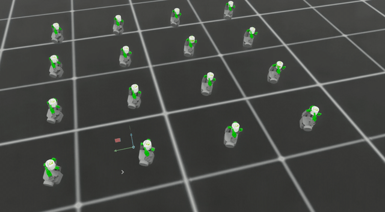

# Allegro in-hand cylinder rolling

A standalone Isaac Lab project for rolling a cylinder with the Allegro hand, starting from cached stable grasps.
Extracted from [Isaac Lab PR #6345](https://github.com/isaac-sim/IsaacLab/pull/6345).



## Installation

Use Linux x86-64, Python 3.12, [uv](https://docs.astral.sh/uv/), and a compatible NVIDIA GPU/driver.
The initial integration targets Isaac Sim PhysX. The package pins the official Isaac Lab source revision used by
its originating PR; it does not depend on the author's fork or a local Isaac Lab checkout.
The first sync downloads the Isaac Sim runtime. To also predownload extension caches, add `--extra extscache` to
`uv sync`; these caches are optional and substantially increase the initial download size.

```bash
uv sync --extra isaacsim --locked
uv run --extra isaacsim isaaclab list_envs
```

At first runtime use, NVIDIA Omniverse Kit asks you to accept its
[EULA](https://docs.omniverse.nvidia.com/platform/latest/common/NVIDIA_Omniverse_License_Agreement.html).
After reviewing and accepting it, unattended runs can set `OMNI_KIT_ACCEPT_EULA=YES` in their environment.

Task discovery is provided by the installed `isaaclab.tasks` entry point:

| Task | Purpose |
| --- | --- |
| `IsaacContrib-Inhand-Roll-Allegro-v0` | Train and play the rolling policy |
| `IsaacContrib-Inhand-Rotate-Grasp-Allegro-v0` | Generate stable reset states |

The original task IDs are retained for compatibility. These tasks are maintained by this external project.

## Use the supplied grasp cache

The package includes the original 50,000-row cache for cylinder scale 0.8. Loading the default cache does not depend
on the shell's working directory and works from an installed wheel.

```bash
uv run allegro-score-grasps --json
uv run --extra isaacsim allegro-view-grasps --num_envs 16 --steps 100 --viz none
uv run --extra isaacsim allegro-view-grasps --num_envs 1 --viz newton_gl --real-time
```

`newton_gl` displays the same PhysX simulation through OpenGL. The Kit viewer is also available with `--viz kit`,
but currently crashes during RTX startup on the development host (RTX 5880 Ada, Linux driver 580.178.04).
See [validation](docs/VALIDATION.md) for the tested graphics path and remaining limitations.

Generate a replacement cache when changing cylinder scales, hand initialization, or grasp criteria:

```bash
uv run --extra isaacsim allegro-generate-grasps --num_envs 4096 --max_cache_rows 50000 --output outputs/grasp_cache/allegro_grasp_linspace --viz none
```

The scale suffix is appended automatically; the default output is
`outputs/grasp_cache/allegro_grasp_linspace_0.8-0.8-1.npy`. New data is written outside the installed package.

```bash
uv run allegro-score-grasps --cache outputs/grasp_cache/allegro_grasp_linspace_0.8-0.8-1.npy --json
```

## Pretrained policy

The package includes the original `model_1499.pt` checkpoint from experiment `2026-08-01_20-45-00` in the PR checkout.
Its bytes and learned normalization statistics are retained without conversion. It uses 121 observations and 16 actions.
The cylinder retains its density-derived mass, approximately 0.164 kg at scale 0.8.

View the trained rolling policy in an OpenGL window:

```bash
uv run --locked --extra isaacsim allegro-evaluate --num_envs 1 --steps 10000 --viz newton_gl --real-time
```

Evaluate at a fixed gravity of -10 m/s² with the gravity curriculum disabled:

```bash
uv run --locked --extra isaacsim allegro-evaluate --num_envs 64 --steps 1200 --seed 7 --viz none --output outputs/evaluation.json
```

Use `--checkpoint /absolute/path/to/model.pt` to evaluate another compatible RSL-RL checkpoint. Each run reports
checkpoint identity, finite-value checks, rotation, displacement, drop events, and the actual object mass.
The reported success metric is a time average of the task's success flag; it is not an episode success percentage.

Across two seeds, the bundled policy averaged about 4.6 turns per environment over 40 simulated seconds. One drop
was observed among 256 completed episodes. See [policy provenance and results](docs/PRETRAINED_POLICY.md).
The historical GIF above has not been matched to an exact checkpoint.

## Train and play a new policy

```bash
uv run --extra isaacsim isaaclab train --rl_library rsl_rl --task IsaacContrib-Inhand-Roll-Allegro-v0 --num_envs 4096 --max_iterations 1500 --viz none
```

To train from a replacement cache, append `env.grasp_cache_path=/absolute/path/to/cache.npy`.
Checkpoints are written to `logs/rsl_rl/allegro_inhand_roll/`.

Play a trained checkpoint at final gravity:

```bash
uv run --extra isaacsim isaaclab play --rl_library rsl_rl --task IsaacContrib-Inhand-Roll-Allegro-v0 --num_envs 16 --checkpoint /absolute/path/to/model.pt --viz newton_gl env.gravity_curriculum=false 'env.sim.gravity=[0.0,0.0,-10.0]'
```

The official play command exports files beside the input checkpoint. Use `allegro-evaluate` to preview the packaged
policy without writing into the installed package.

## Development

```bash
uv run pytest
uv run ruff check .
uv run ruff format --check .
uv build
```

Package structure:

```text
src/allegro_inhand/
  assets/data/                cylinder, texture, grasp cache, and pretrained policy
  tasks/allegro_rotate/       direct environments and PPO configuration
  tools/                      cache commands and fixed-gravity policy evaluation
docs/PROVENANCE.md             source revision, resource provenance, and ownership
```

See [provenance](docs/PROVENANCE.md) and [validation](docs/VALIDATION.md) for the pinned revision and checked behavior.
The Newton configuration is inherited from the PR and is not part of the initial compatibility claim.
